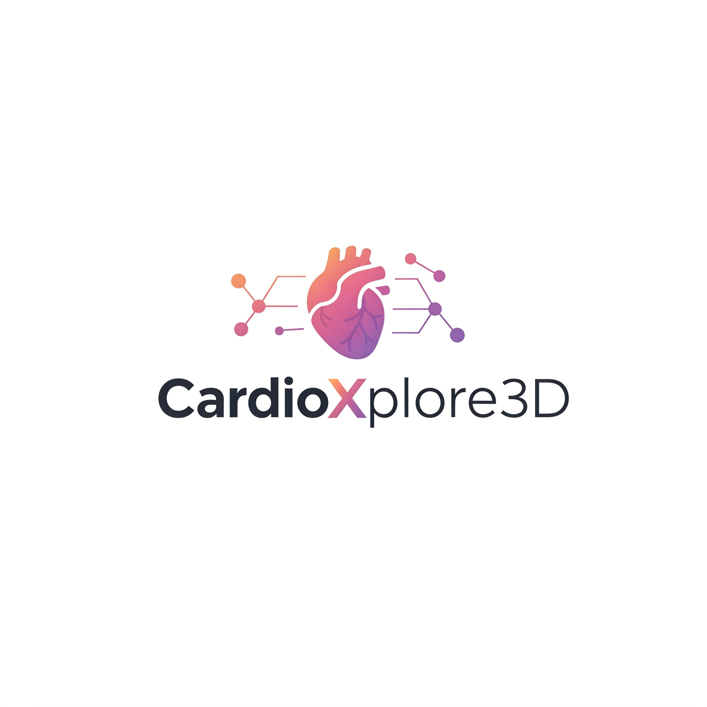
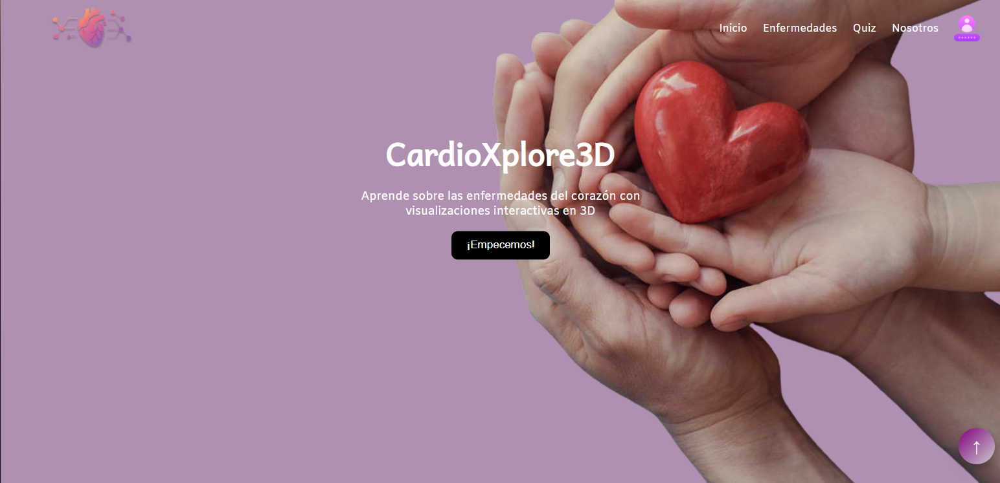
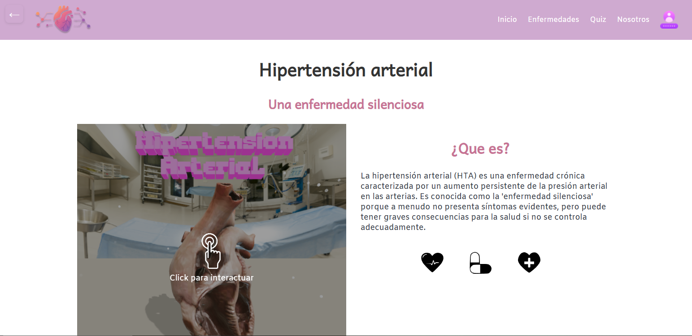
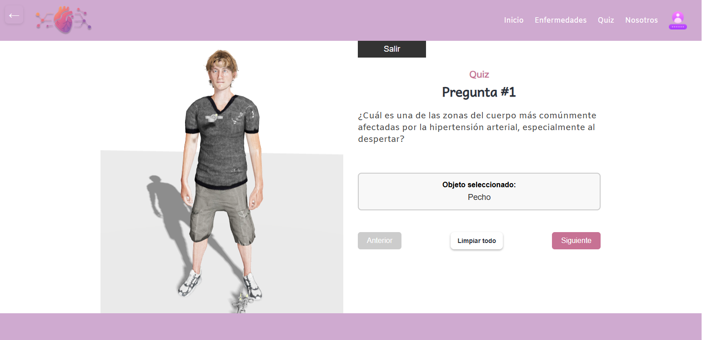

# 🫀 CardioXplore3D

**Plataforma educativa interactiva en 3D para el aprendizaje de enfermedades cardiovasculares**

Proyecto: https://cardio-xplore3-d.vercel.app


Logo 

App 

Enfermedades 

Quiz 


## 📋 Descripción del Proyecto

CardioXplore3D es un **proyecto académico universitario** que simula una aplicación web educativa utilizando tecnologías 3D para explorar enfermedades cardiovasculares. La plataforma combina modelos tridimensionales interactivos, animaciones, y sistemas de evaluación gamificados como demostración de habilidades técnicas en desarrollo web 3D.

> **⚠️ Nota Importante**: Este es un proyecto educativo universitario con fines de aprendizaje y demostración de competencias técnicas. No pretende ser 100% fiel a la medicina real y no debe utilizarse como fuente de información médica profesional.

### 🎯 Objetivo Principal

Demostrar el desarrollo de una herramienta educativa innovadora utilizando tecnologías web 3D modernas, implementando visualizaciones interactivas de conceptos cardiovasculares como ejercicio académico para el aprendizaje de React, Three.js y desarrollo full-stack.

## ✨ Características Principales

### 🔬 Módulos de Enfermedades
- **Enfermedad Arterial Coronaria (EAC)**: Visualización de arterias obstruidas y flujo sanguíneo
- **Embolia Cerebral (EC)**: Modelos 3D del sistema circulatorio cerebral  
- **Hipertensión Arterial (HA)**: Simulaciones de presión arterial y efectos en órganos
- **Insuficiencia Cardíaca (IC)**: Animaciones del funcionamiento cardíaco alterado

### 📚 Secciones Educativas por Enfermedad
- **¿Qué es?**: Definiciones con modelos 3D explicativos
- **Síntomas**: Visualizaciones anatómicas de manifestaciones clínicas
- **Tratamientos**: Modelos interactivos de procedimientos médicos
- **Prevención**: Simulaciones de hábitos saludables

### 🎮 Sistema de Quiz Interactivo
- **Modelos 3D Clickeables**: Identificación de partes anatómicas
- **Animaciones de Jeringas**: Sistema de feedback visual inmersivo
- **Evaluación en Tiempo Real**: Puntuación y retroalimentación instantánea
- **Navegación Intuitiva**: Progreso fluido entre preguntas

### 🎨 Experiencia Visual Avanzada
- **Entornos 3D Realistas**: Ambientaciones médicas (hospital, gimnasio)
- **Sistema de Iluminación Dinámico**: Controles de luz interactivos
- **Física Realista**: Simulaciones con gravedad y colisiones
- **Animaciones Fluidas**: Transiciones suaves y naturales

## 🛠️ Tecnologías Utilizadas

### 🎨 Frontend
- **React 19** - Framework principal de UI
- **React Three Fiber** - Renderizado 3D en React
- **Three.js** - Biblioteca 3D core
- **@react-three/drei** - Utilidades y componentes 3D
- **@react-three/rapier** - Motor de física 3D
- **React Router DOM** - Navegación y enrutamiento
- **Zustand** - Gestión de estado global
- **React Icons** - Iconografía moderna
- **Vite** - Herramienta de build ultrarrápida

### 🔧 Backend
- **Node.js** - Runtime de JavaScript
- **Express.js** - Framework web para APIs
- **MongoDB** - Base de datos NoSQL
- **Mongoose** - ODM para MongoDB
- **Firebase Admin** - Servicios de backend en la nube
- **CORS** - Configuración de políticas de origen cruzado

### 🎯 Herramientas de Desarrollo
- **ESLint** - Linting y calidad de código
- **Nodemon** - Desarrollo con hot reload
- **Vite Dev Server** - Servidor de desarrollo con HMR
- **Git** - Control de versiones

### 🎨 Recursos 3D y Multimedia
- **Modelos GLTF/GLB** - Formatos 3D optimizados
- **Texturas HDRi** - Mapas de entorno realistas
- **Cubemaps** - Reflejos ambientales
- **Fuentes Web** - Tipografía personalizada (PIXELAND)
- **Audio MP3** - Efectos sonoros inmersivos

## 📁 Estructura del Proyecto

```
CardioXplore3D/
├── 📂 backend/                    # Servidor Node.js
│   ├── server.js                  # Servidor principal
│   ├── models/                    # Modelos de datos
│   │   ├── User.js               # Modelo de usuario
│   │   └── quizResponse.js       # Modelo de respuestas
│   └── routes/                    # Rutas de API
│       ├── userRoutes.js         # Rutas de usuarios
│       └── quizRoutes.js         # Rutas de quiz
├── 📂 src/                        # Código fuente frontend
│   ├── pages/                     # Páginas principales
│   │   ├── diseases/             # Módulo de enfermedades
│   │   │   ├── EAC/             # Enfermedad Arterial Coronaria
│   │   │   ├── EC/              # Embolia Cerebral
│   │   │   ├── HA/              # Hipertensión Arterial
│   │   │   ├── IC/              # Insuficiencia Cardíaca
│   │   │   ├── Lights/          # Sistema de iluminación
│   │   │   └── PointEvent/      # Eventos de interacción
│   │   ├── quiz/                 # Sistema de evaluación
│   │   │   ├── questions/       # Preguntas del quiz
│   │   │   │   ├── modelos3D/   # Modelos 3D del quiz
│   │   │   │   └── hooks/       # Hooks personalizados
│   │   │   └── resultados/      # Resultados del quiz
│   │   ├── home/                # Página principal
│   │   ├── login/               # Autenticación
│   │   └── profile/             # Perfil de usuario
│   ├── components/               # Componentes reutilizables
│   ├── layout/                   # Componentes de layout
│   └── stores/                   # Gestión de estado
├── 📂 public/                     # Recursos estáticos
│   ├── models-3d/               # Modelos 3D (.glb)
│   │   ├── EAC/                 # Modelos de EAC
│   │   ├── EC/                  # Modelos de EC
│   │   ├── HA/                  # Modelos de HA
│   │   ├── IC/                  # Modelos de IC
│   │   └── Quiz/                # Modelos del quiz
│   ├── environment/             # Entornos 3D
│   │   ├── cubemaps/           # Mapas de cubos
│   │   └── hdris/              # Texturas HDRi
│   ├── img/                     # Imágenes y texturas
│   └── sounds/                  # Efectos de audio
└── 📂 config/                     # Archivos de configuración
    ├── vite.config.js           # Configuración de Vite
    ├── eslint.config.js         # Configuración de ESLint
    └── firebase.config.js       # Configuración de Firebase
```

## 🎓 Aprendizajes y Conocimientos Adquiridos

### 🎨 Desarrollo 3D Web
- **Renderizado 3D en tiempo real** con Three.js y React Three Fiber
- **Optimización de performance** para modelos 3D complejos
- **Sistemas de iluminación avanzados** (ambiental, direccional, puntual)
- **Física realista** con motores de colisiones
- **Animaciones fluidas** y transiciones suaves

### ⚡ Arquitectura Frontend Moderna
- **Componentes reutilizables** y modulares en React
- **Hooks personalizados** para lógica compleja
- **Gestión de estado global** con Zustand
- **Enrutamiento dinámico** con React Router
- **Optimización de bundle** con Vite

### 🔧 Desarrollo Backend Robusto
- **APIs RESTful** escalables con Express.js
- **Modelado de datos** NoSQL con MongoDB
- **Autenticación y autorización** con Firebase
- **Manejo de archivos** multimedia
- **Configuración de CORS** para seguridad

### 🎮 Gamificación Educativa
- **Sistemas de quiz interactivos** con feedback inmediato
- **Animaciones de recompensa** para motivar el aprendizaje
- **Progresión no lineal** adaptada al usuario
- **Evaluación en tiempo real** con métricas detalladas

### 🏗️ DevOps y Herramientas
- **Control de versiones** avanzado con Git
- **Linting y formateo** automático de código
- **Hot Module Replacement** para desarrollo ágil
- **Gestión de dependencias** y versionado

## 👥 Equipo de Desarrollo

**Juan Fernando Duque Jojoa**
- GitHub: [@JuanFDJ73](https://github.com/JuanFDJ73)
- LinkedIn: [Juan Fernando Duque](https://linkedin.com/in/juanfdj73)

**Daniel Enriquez**
- GitHub: [@DaniJER](https://github.com/DaniJER)
- LinkedIn: [Daniel Enriquez](https://www.linkedin.com/in/daniel-enriquez-700396206)

**Marvin Valencia**
- GitHub: [@MarvinV22](https://github.com/marvincampo311)
- LinkedIn: [Marvin yessid Valencia olmos](https://www.linkedin.com/in/marvin-yessid-valencia-olmos-6a92a2280)

**Santiago Vega**
- GitHub: [@Santiago Vega](https://github.com/PacmanLloron)
- LinkedIn: [Santiago Vega Monroy](https://www.linkedin.com/in/santiago-vega-monroy-4998b4161)

### 🏫 Institución Académica
- **Universidad del Valle (Univalle)**
  - Proyecto académico de investigación y desarrollo
  - Facultad de Ingeniería

### 🎨 Especialidades del Equipo
- **Desarrollo Web Full Stack**
- **Programación 3D y Gráficos**
- **Diseño de Experiencia de Usuario (UX/UI)**
- **Educación Médica Digital**
- **Optimización de Performance Web**

## 📈 Logros y Métricas del Proyecto

### 🎯 Logros Técnicos
- ✅ **+15 modelos 3D** optimizados y funcionales
- ✅ **Sistema de física realista** implementado
- ✅ **4 módulos educativos** completos
- ✅ **Quiz interactivo** con animaciones avanzadas
- ✅ **Sistema de autenticación** robusto
- ✅ **Performance optimizada** (<3s tiempo de carga)

### 📚 Impacto Educativo
- 🎓 **Mejora significativa** en la comprensión de conceptos
- 📊 **Mayor retención** de conocimientos vs métodos tradicionales
- 🎮 **Alta engagement** del usuario con contenido gamificado
- 🔬 **Visualización práctica** de conceptos médicos complejos

## 📞 Contacto

- **Proyecto**: [CardioXplore3D](https://github.com/DaniJER/CardioXplore3D)
- **Universidad**: Universidad del Valle

## ⚠️ Disclaimer Académico

**Este proyecto fue desarrollado con fines académicos y educativos como parte de la formación universitaria en desarrollo de software.** 

- ✅ **Propósito**: Demostración de habilidades técnicas en desarrollo web 3D
- ✅ **Enfoque**: Proyecto de aprendizaje y portafolio profesional  
- ❌ **No es**: Un recurso médico profesional o clínicamente validado
- ❌ **No sustituye**: Consulta médica, diagnóstico o tratamiento profesional

La información médica presentada es de carácter general y con fines demostrativos. Para información médica precisa, consulte siempre con profesionales de la salud calificados.

---

*Desarrollado con ❤️ como proyecto de aprendizaje y demostración de habilidades*
